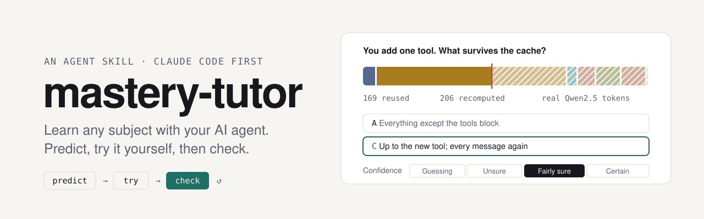
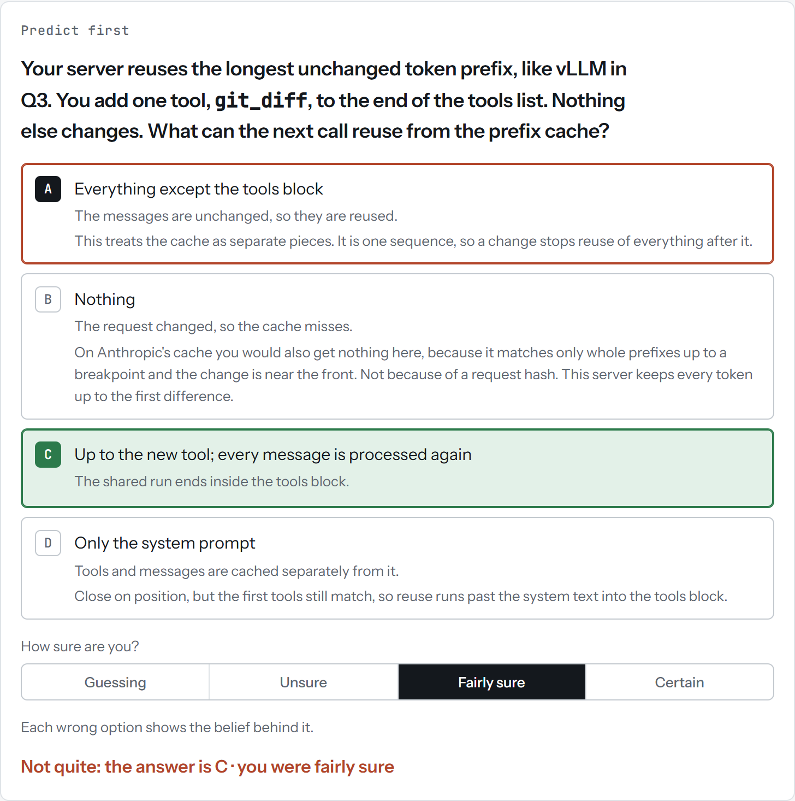
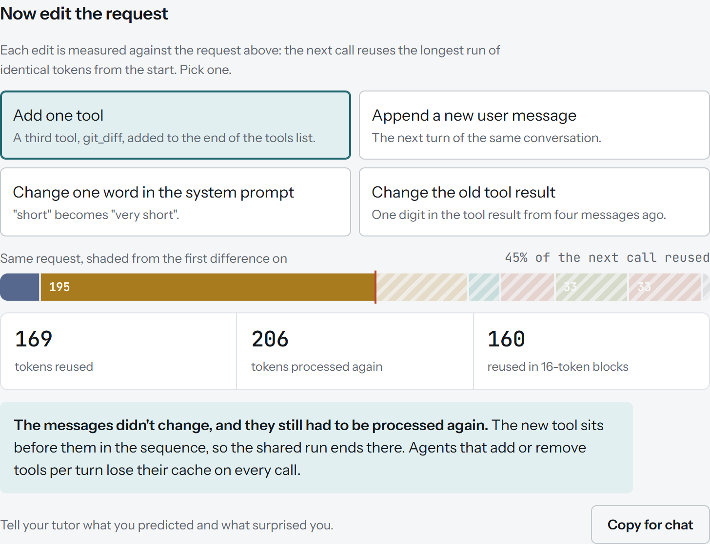
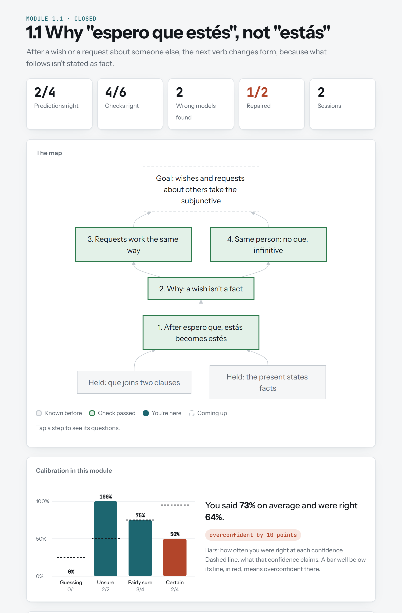
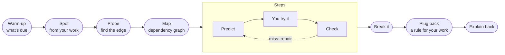

<div align="center">

<picture>
  <source media="(prefers-color-scheme: dark)" srcset="docs/images/banner-dark.svg">
  
</picture>

<p>
  <a href="https://github.com/ITZSHOAIB/mastery-tutor/actions/workflows/ci.yml"></a>
  <a href="LICENSE"></a>
  <a href="https://agentskills.io"></a>
  <a href="#install"></a>
  <a href="CONTRIBUTING.md"></a>
</p>

**A tutoring skill for any subject, for Claude Code and other AI agents.**<br>
It doesn't explain topics to you. It makes you predict, try it yourself, and check,<br>
and it keeps a record of what you actually know.

[Install](#install) · [What a session looks like](#what-a-session-looks-like) · [How it teaches](#how-it-teaches) · [Any subject](#any-subject) · [Works with](#works-with) · [FAQ](#faq)

</div>

---

Ask a chatbot to teach you something and you get a well-written summary that you forget by Friday. **mastery-tutor** turns your agent into a tutor that works the other way round:

- 🎯 **Finds your edge first.** Two to four probing questions decide what to skip and where to start. Nothing you already know gets re-taught.
- 🔮 **Predict before you see.** Every step opens with a multiple-choice prediction and a confidence rating. Each wrong option is built from a specific misconception, so a miss shows *which* wrong model you hold.
- 🧪 **You try it, not the tutor.** Run the code, read the source, say the sentence, play the passage. The tutor teaches from what you saw.
- 🧠 **Confident and wrong gets caught.** Those are the beliefs that quietly break your work. They're named, traced, repaired and retested later.
- 📚 **Sourced, not remembered.** Before planning, a separate agent finds the authoritative sources. Before each module, every claim it rests on is checked against them, with a quote and a date. What can't be supported isn't taught as fact, and your own result beats any source.
- 📅 **Spaced review.** Every check is logged and scheduled with [FSRS](https://github.com/open-spaced-repetition/py-fsrs), so ideas come back just before you'd forget them.
- 📁 **Plain markdown records.** Roadmap, session logs, misconceptions and reviews live in a folder you own. Switch agents, devices or models and nothing is lost.

## Install

<table>
<tr><td><b>Claude Code</b> (plugin, recommended)</td><td>

```text
/plugin marketplace add ITZSHOAIB/mastery-tutor
/plugin install mastery-tutor@mastery-tutor
```

</td></tr>
<tr><td><b>Claude Code, Codex, Cursor, Gemini CLI, Copilot, OpenCode…</b><br>(<a href="https://github.com/vercel-labs/skills">Skills CLI</a>)</td><td>

```bash
npx skills add ITZSHOAIB/mastery-tutor
```

</td></tr>
<tr><td><b>claude.ai / Claude desktop</b></td><td>

Zip the skill folder and upload it under **Customize → Skills** (not yet tested; records are printed at session end for you to keep):

```bash
cd skills && zip -r mastery-tutor.zip mastery-tutor
```

</td></tr>
<tr><td><b>Anything else</b></td><td>

Copy `skills/mastery-tutor/` into your agent's skills folder, or paste `SKILL.md` into a chat and follow the [plain-chat adapter](skills/mastery-tutor/references/adapter-plain-chat.md).

</td></tr>
</table>

Then just ask:

```text
> Teach me how Rust's borrow checker actually works. I write Go every day.
> I want to read Spanish news without a dictionary by summer.
> Help me understand the causes of the First World War well enough to argue about them.
```

In Claude Code you can also call it directly with `/mastery-tutor:mastery-tutor` (plugin) or `/mastery-tutor` (Skills CLI).

## What a session looks like

An illustrative excerpt from module 1.1 of a topic on LLM internals:

> **Tutor:** Your agent sends a `messages` array and a `tools` list. You add one tool, `git_diff`, to the end of that list. Nothing else changes. What can the next call reuse from the prefix cache?
>
> **A** · everything except the tools block  **B** · nothing  **C** · up to the new tool; every message is processed again  **D** · only the system prompt
>
> *How sure are you?* Guessing · Unsure · **Fairly sure** · Certain
>
> **You:** A, fairly sure. The messages didn't change.
>
> **Tutor:** Wrong. **Answer: C**, up to the new tool. The template renders tools as text near the front of the sequence, so the shared run ends inside the tools block and every message after it is recomputed. A treats the cache as separate pieces per section; it's one sequence. Your reasoning held on "the messages didn't change" and broke on where they *sit*. Run cell 2.3 and compare the two token counts.

For ideas that change with a setting, the tutor offers a single-purpose page with **real measured data**, and builds it only if you say yes. The page asks the prediction first and keeps everything locked until you commit:

<div align="center">
<table>
<tr>
<td width="50%" valign="top">
<picture>
  <source media="(prefers-color-scheme: dark)" srcset="docs/images/reveal-dark.png">
  
</picture>
<p align="center"><sub><b>Predict, then reveal.</b> Wrong options show the belief behind them.</sub></p>
</td>
<td width="50%" valign="top">
<picture>
  <source media="(prefers-color-scheme: dark)" srcset="docs/images/poke-dark.png">
  
</picture>
<p align="center"><sub><b>Then poke it.</b> Real tokenizer counts, plus a line to paste back into chat.</sub></p>
</td>
</tr>
</table>

<sub>The page is <a href="examples/cache-explorer/">examples/cache-explorer</a>. Download <code>cache-explorer.html</code> and open it in a browser.</sub>
</div>

When a module closes, the tutor offers a recap page built from your records: the numbers count up, the map's steps open the questions you answered on them, and the calibration chart shows where your confidence ran ahead of you.

<div align="center">
<picture>
  <source media="(prefers-color-scheme: dark)" srcset="docs/images/recap-dark.png">
  
</picture>
<p><sub>A recap from a sample Spanish topic. Pages are built only if you say yes.</sub></p>
</div>

### Things you can say

No commands to learn. Steer in plain words at any point:

| Say | You get |
|---|---|
| "Show me this" | A visual page for the current step, built around what you got wrong |
| "Where am I?" | The module map with your position |
| "Recap this module" | One page: the map, your numbers, calibration, the wrong models you fixed and your rule (also offered when a module closes) |
| "What's due?" / "Quiz me" | Spaced review of earlier modules |
| "How calibrated am I?" | How often you're right at each confidence level, and how that's changing |
| "Give me a problem" | A practice problem that doesn't name the idea it needs |
| "Can we role-play it?" | The tutor plays the other side (your manager, a colleague abroad, a patient), then steps out to check |
| "Skip this, I know it" | One question on it, then skip ahead if you're right |
| "Is that true?" | A fact check, with what's uncertain said plainly |
| "Use my notes" | Your textbook, course notes or past exam (in `sources/`) shape the plan, the citations and the practice, and their mistakes get flagged |
| "Stop here" | Your place is saved; next session resumes there |

## How it teaches

Every module runs the same loop. Each stage has its own reference file the agent re-reads before running it, and every check feeds the review log that brings ideas back as warm-ups.



| Stage | What happens |
|---|---|
| **Plan** | A short interview about your goal, your work, your constraints and any material you already have (a textbook, course notes, a past exam). The result is a roadmap of phases and modules, each anchored in something you already do and paired with a try: something you'll run, read, say or do. A fresh subagent then reviews the roadmap as an outside expert. |
| **Probe** | It starts with high-level questions and walks down until it finds the edge of what you know. |
| **Steps** | Predict, try, check. At most one prediction and one check per step. A missed check gets repaired before anything builds on it. |
| **Close** | **Break it** (change one thing and explain what happened), **Plug back** (one rule for your own work) and **Explain back** (the module goal in your words, graded strictly). A module isn't done without all three. |
| **Practice** | One session per phase: problems that never name the idea they need, hints one level at a time, and every miss retested in a new form. |

## Any subject

The loop is the same for every topic. What changes is the **try**, the thing you do between predicting and checking:

| You want to learn | A try looks like |
|---|---|
| 💻 Programming, ML, data | Run a cell, or change one value in a working one |
| 📐 Maths, physics, economics | A calculation by hand, a measurement at home, a simulation with a slider |
| 🗣️ A language | Say or write it, then check a native source; guess which form a native speaker would use; a scene with the tutor as the other speaker |
| 📜 History, law, philosophy, literature | Predict what a primary source says or how a case was decided, then read it; argue a side and meet the strongest reply |
| 🎸 Music, drawing, cooking, a sport | Do it, change one thing (tempo, heat, grip), describe or record what happened |
| 🤝 Negotiation, management, clinical cases | A role-play with the tutor as the other side, or a case decision, then compare with what really happened |

Questions, confidence, misconceptions, spaced review and the module close work the same everywhere.

## What it writes

Everything is markdown you can read, diff and commit:

```text
rust-ownership/
├── AGENTS.md / CLAUDE.md     rules your agent loads every turn
├── ROADMAP.md                your profile, endpoint, phases and modules
├── sources/                  your textbook, notes or past exams, indexed and cited
├── PROGRESS.md               module status and calibration: is "Certain" actually right?
├── knowledge/
│   ├── propositions.md       what was taught, and the evidence you hold it
│   ├── misconceptions.md     wrong models found, and whether they're repaired
│   └── reviews.md            the review log that FSRS schedules from
├── sessions/
│   └── 2026-11-17-1.1.md     every question: key written first, your answer, confidence, verdict
└── phase-1-moves/1.1-what-a-move-is/
    ├── notes.md              module map (mermaid), Break it, Plug back, Explain back
    ├── lab.md                your tries: prediction, what you did, what it showed
                              (lab.ipynb for topics that compute)
    └── visuals/              pages you said yes to: a step's visual, the map, the module recap
```

## Works with

The method is written against **capabilities**, not tools. A short adapter per environment maps them to real tools. When a capability is missing, a fallback keeps the method working with more manual steps.

| Capability | Claude Code | Codex · Cursor · Gemini CLI · … | Plain chat |
|---|:---:|:---:|:---:|
| Structured questions with confidence | ✅ native picker | ✅ text options | ✅ text options |
| Read and write the topic folder | ✅ | ✅ | 📋 paste in and out |
| Tries you do yourself | ✅ lab book or notebook | ✅ lab book or notebook | 📋 do it, paste the result |
| Fact-checking on the web | ✅ | ⚙️ if enabled | ➖ flags unverified facts |
| Background subagents | ✅ | ⚙️ if available | ➖ inline |
| Interactive visuals | ✅ published Artifact | ✅ local HTML | ⚙️ mermaid / artifacts |
| Rules loaded every turn | ✅ `CLAUDE.md` | ✅ `AGENTS.md` | ➖ |
| Continue from your phone | ⚙️ Remote Control | ➖ | ✅ |

Claude Code is the primary target and the most tested: a full session, plus plugin install from this repo. For other coding agents, the Skills CLI install and the scripts are tested; a full session there is not yet, so reports are welcome. Adapters: [Claude Code](skills/mastery-tutor/references/adapter-claude-code.md) · [other coding agents](skills/mastery-tutor/references/adapter-coding-agents.md) · [plain chat](skills/mastery-tutor/references/adapter-plain-chat.md). Want another one? [Open an adapter request](https://github.com/ITZSHOAIB/mastery-tutor/issues/new?template=adapter_request.yml).

## Principles

- **Mastery before moving on.** Named after *mastery learning*: a module closes only when every check has passed and you can break it, apply it and explain it back. Misses are repaired on the spot and come back in spaced review.
- **Earned, not delivered.** You can say *why* the module's goal must be true, from facts you already own. Being able to repeat it doesn't count.
- **Wrong and sure is the jackpot.** Confidence is recorded with every answer, because a confident miss is the most useful thing a question can find.
- **The learner does the trying.** An answer you got from your own attempt sticks. One the tutor reports is just another sentence.
- **Grounded in sources.** A model's memory is stale and unlabelled. A claim counts as checked only with a quoted passage from a named source; moving areas (versions, law, prices) are rechecked after 90 days, and errors found later are corrected in the records and in review.
- **Dry voice.** No praise and no hype. Uncertainty gets said out loud. The fun comes from tries that surprise you.
- **Markdown is the record.** Every page, map and chart is generated from it and can be thrown away.
- **Evidence before tooling.** New machinery ships only after real sessions show it's needed.
- **Small context.** The agent reads `SKILL.md` and one short reference per stage, not the whole method. Rarely used detail (role-play, adapters) sits in its own file, and CI holds every file to a word budget.

## Repository layout

```text
skills/mastery-tutor/
├── SKILL.md                 entry point: situations, loop, rules every turn
├── references/              the method (one file per stage, plus role-play) and the adapters
├── scripts/                 new_topic.py · due.py · calibration.py · map_view.py · recap.py · build_visual.py · page_style.py
└── assets/                  topic scaffold, lab book, notebook, session log, visual starter
examples/cache-explorer/     a real visual, its data script and measured data
.claude-plugin/              Claude Code plugin + marketplace manifests
tests/                       script tests and the skill checker CI runs
```

## FAQ

<details>
<summary><b>What topics does it work for?</b></summary>

Any subject where understanding can be checked: see [Any subject](#any-subject). Nothing in the method assumes code. Code only matters for topics that compute; everything else uses a markdown lab book. Pure memorisation (vocabulary lists, flags of the world) works too, but a flashcard app is lighter for that alone.
</details>

<details>
<summary><b>Won't it teach outdated things from its training data?</b></summary>

That's the risk it's built against (`references/grounding.md`). Planning starts with research: a separate agent finds official docs, statutes, standards, papers and current textbooks, and indexes them with tier, version and access date. Before each module, a separate agent checks every claim the module rests on and must return a quote and its place for each; anything without one is marked unverified and not taught as fact. Moving areas are rechecked before review after 90 days. This makes each claim supported, dated and correctable, not infallible. Without web access, the tutor says so up front and marks moving claims unverified.
</details>

<details>
<summary><b>Do I need Python?</b></summary>

Not for the tutoring. The scripts help: `due.py` schedules reviews (it needs `fsrs`, which `uv run` installs automatically), `calibration.py` counts how often you're right at each confidence level, `map_view.py` draws your position on the module map, and `recap.py` builds the module recap. Without code execution, the tutor uses a fixed review ladder, counts calibration by hand and draws mermaid diagrams instead.
</details>

<details>
<summary><b>How long is a session?</b></summary>

A concept module takes about 45–60 minutes. Longer modules span several sessions, and the records carry state between them, so you can stop anywhere and resume in a new chat, a new agent or on another machine.
</details>

<details>
<summary><b>Can I use it on my phone?</b></summary>

In Claude Code, start the session with `claude --rc` (Remote Control) and continue it from the Claude app. Visual pages open from their link. Long work is painful on a phone, so the method switches to small edits there: change one value, swap one word, rewrite one sentence. Remote Control hasn't been tested much with this skill yet; please report what you find.
</details>

<details>
<summary><b>Where does the data go?</b></summary>

Into the topic folder on your machine, and nowhere else. Visual pages published as Claude Artifacts are private by default.
</details>

<details>
<summary><b>Why not a web app or a dashboard?</b></summary>

One was built, then frozen. In real sessions, chat plus the occasional one-idea page did the job at a fraction of the cost. See *Evidence before tooling*. Pages are always offered first and built only on a yes, and a recap page closes each module if you want one.
</details>

## Contributing

Issues and PRs are welcome, especially new adapters and method changes backed by real sessions. Read [CONTRIBUTING.md](CONTRIBUTING.md) and the [Code of Conduct](CODE_OF_CONDUCT.md). Report security issues privately, as described in [SECURITY.md](SECURITY.md).

## Credits

Several ideas were shaped by studying [LearnHarness](https://github.com/amosblomqvist/learnharness) by Eero Alvar. No text or code from it is included. Details are in [CREDITS.md](CREDITS.md). Review scheduling uses [py-fsrs](https://github.com/open-spaced-repetition/py-fsrs).

## License

[MIT](LICENSE) © ITZSHOAIB
