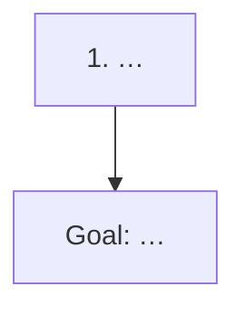

# {{MODULE}}

**Goal:** _the module's goal from ROADMAP.md_

## Map (v1)

## Steps

_Filled in during the session: one line per step on what the output showed._

## Break it

_What the learner changed, their prediction, what happened._

## Plug-back rule

_In the learner's words._

## Explain back

_The learner's words, then the corrected version if needed._
